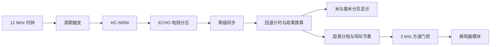

# FPGA 超声波测距与距离提示系统

[](https://github.com/yangdaniu8-ui/step-max10-ultrasonic-ranging/actions/workflows/rtl-simulation.yml)

基于 **STEP MAX10、Verilog 和 HC-SR04** 的完整 FPGA 实践项目：测量回波脉宽、计算厘米距离，使用两位板载数码管分页显示，并通过 2 kHz 蜂鸣器提示音表达远近。

已完成 RTL 自检仿真、Quartus 综合与布局布线、静态时序分析、板上调试和配置 Flash 写入校验。板上观察确认测距读数、距离提示节奏和显示自检有效；蜂鸣器从直流门控改为 2 kHz 驱动后，声音明显更清晰。

> 工程目标：`10M08SCM153C8G`，板载时钟 12 MHz。接线前核对实际开发板版本和器件型号。HC-SR04 的 ECHO 必须先降到兼容 FPGA 的电平。

## 功能

| 项目 | 实现 |
| --- | --- |
| 测量范围 | 按四舍五入结果接受 2–400 cm |
| 测量周期 | 每秒一次 |
| 触发脉冲 | 20 μs，高电平 240 个时钟 |
| 回波处理 | 两级同步、脉宽测量、30 ms 超时、异常恢复 |
| 距离换算 | 采用 340 m/s 声速，余数累加器完成整数厘米换算 |
| 数码管 | 两位共阴极，整数米／两位厘米交替显示 |
| 声音提示 | 2 kHz、50% 占空比，鸣叫节奏随距离变化 |
| 复位 | 上电复位，KEY1 异步复位并同步释放 |
| 断电保留 | MAX10 内部配置 Flash，POF 写入及独立 Verify 已通过 |

## 系统结构



## 硬件接线

当前工程分配使用开发板丝印 **GPIO3、GPIO4、GPIO5**，不是 DIP 排针的物理脚号。

| 外设信号 | STEP MAX10 连接点 | FPGA 球位 |
| --- | --- | --- |
| HC-SR04 VCC | VBUS，USB 供电时为名义 5 V | 电源引出点 |
| HC-SR04 GND | GND | 共地 |
| HC-SR04 TRIG | GPIO3 | R3 |
| HC-SR04 ECHO | **分压中点接 GPIO4** | L6 |
| BEEP V2.0 IO | GPIO5 | P4 |
| BEEP V2.0 VCC | 3.3V，当前模块已在此供电下测试 | 电源引出点 |
| BEEP V2.0 GND | GND | 共地 |

数码管、LED、时钟和按键使用板载资源。普通 5 V HC-SR04 的 ECHO 不直接连接 3.3 V FPGA 输入。

两只相同 **2 kΩ** 电阻的接法：

```text
HC-SR04 ECHO ----[ 2 kΩ ]----+---- GPIO4 / L6
                            |
                         [ 2 kΩ ]
                            |
                           GND
```

ECHO 为 5 V 时，中点约 `5 × 2/(2+2) = 2.5 V`。下方电阻必须接到共地，不能悬空；只串联一只电阻不能形成这个分压。

完整引脚表和模块差异见 [接线说明](docs/WIRING.md)。

## 显示与提示音

两位数字每秒切换一次显示页：先显示整数米及小数点，再显示两位厘米。每两页使用同一次锁存数据，避免把不同测量值拼成一个距离。

| 距离 | 第一页 | 第二页 |
| --- | --- | --- |
| 0.25 m | `0.`，另一位空白 | `25` |
| 1.23 m | `1.`，另一位空白 | `23` |
| 4.00 m | `4.`，另一位空白 | `00` |
| 无效回波／超时 | `--` | `--` |

LED1 亮表示测量有效，LED2 亮表示正在显示整数米页。显示周期为两秒，测距仍每秒执行。

| 距离 | 2 kHz 提示音节奏 |
| --- | --- |
| 2–9 cm | 连续 |
| 10–19 cm | 响 100 ms／停 100 ms |
| 20–39 cm | 响 200 ms／停 200 ms |
| 40–79 cm | 响 300 ms／停 300 ms |
| 80–149 cm | 响 500 ms／停 500 ms |
| 150–400 cm | 响 750 ms／停 750 ms |
| 无效数据 | 静音 |

## 快速复现

### Quartus 编译

使用 Quartus Prime Lite 18.1 或兼容的 MAX10 工具版本。将 Quartus 可执行文件加入 PATH，或设置 `QUARTUS_ROOTDIR`／传入 `-QuartusBin`。

```powershell
.\scripts\build.ps1
# 或：
.\scripts\build.ps1 -QuartusBin '<Quartus bin directory>'
```

也可以直接打开 `quartus/step_ultrasonic.qpf`，执行全编译。使用英文目录可减少旧版工具的路径兼容问题。

### RTL 仿真

安装 Python 3 与 Icarus Verilog 后，跨平台执行：

```text
python scripts/run_iverilog.py
```

ModelSim 用户可将 `vsim` 加入 PATH，或传入其目录：

```powershell
.\scripts\simulate.ps1 -ModelSimBin '<ModelSim bin directory>'
```

测试覆盖测距边界、触发周期、回波超时、恢复、复位、显示分页一致性、距离分档和 2 kHz 波形。GitHub Actions 使用 Icarus 执行同一组自检测试。

### 下载与固化

1. 断电接线，核对 ECHO 分压、共地、供电和器件型号。
2. USB-Blaster 驱动正常后，在 Quartus Programmer 使用 JTAG 连接。
3. `quartus/output_files/step_ultrasonic.sof` 用于临时配置。
4. `quartus/output_files/step_ultrasonic.pof` 用于写入内部配置 Flash；写入后执行 Verify。
5. 断电再上电，检查自动启动、距离读数和提示音。

仓库不提交本机生成的 SOF／POF 或原始工具日志，请从源码重新生成适用于自己板卡的文件。

## 工程组织

```text
rtl/       测距、显示、报警包络、音频载波、复位及显示自检
quartus/   工程文件、引脚约束及 SDC
sim/       SystemVerilog 自检测试平台与 ModelSim do 文件
scripts/   可移植编译与仿真入口
docs/      接线、设计说明及去标识化的验证结果
```

- [设计与调试要点](docs/DESIGN.md)
- [验证结果与已知限制](docs/VALIDATION.md)
- [公开文件范围](docs/PUBLISHING.md)

## 资料来源

硬件接口和时序参考公开厂商资料，RTL 与测试平台在本项目中实现并调试。原始课程报告、个人信息和实物照片不包含在仓库内。

- [STEP MAX10 引脚分配](https://www.stepfpga.com/library/board-doc/FPGA/STEP%20MAX10/STEP%20MAX10%E5%AE%9E%E9%AA%8C%E6%8C%87%E5%AF%BC%E4%B9%A6/%E7%AC%AC%E4%B8%80%E7%AB%A0%20%E5%AE%9E%E9%AA%8C%E5%B9%B3%E5%8F%B0/1.6%20%E5%BC%95%E8%84%9A%E5%88%86%E9%85%8D/)
- [STEP MAX10 数码管说明](https://wiki.stepfpga.com/altera_4seg)
- [HC-SR04 数据手册](https://cdn.sparkfun.com/datasheets/Sensors/Proximity/HCSR04.pdf)
- [MAX10 配置与 Flash 编程资料](https://www.intel.com/programmable/technical-pdfs/max10-handbook.pdf)
